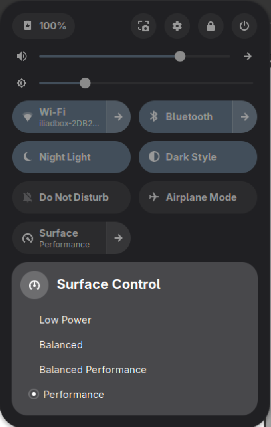

# Surface Control

**GNOME Shell extension for Microsoft Surface hardware.**

[](https://extensions.gnome.org/extension/9696/surface-control/)

Control your Surface device directly from the Quick Settings panel — switch power profiles, cap the battery charge limit, check discrete GPU state, and manage Surface Book detachment without opening a terminal.



---

## Features

### Platform Profiles
Switch between all four power modes from the Quick Settings menu:

| Profile | Description |
|---------|-------------|
| Low Power | Maximum battery savings for reading, writing, light tasks |
| Balanced | Default everyday use — good balance of performance and battery |
| Balanced Performance | Extra headroom for demanding apps without full performance draw |
| Performance | Maximum CPU/GPU throughput, plugged-in use |

The tile shows the active profile. Clicking it toggles between Balanced and your last non-default profile. The chevron opens the full menu for direct selection. Changes made externally are reflected instantly via a kernel sysfs monitor — no polling.

### Panel Indicator
A contextual icon appears in the top bar whenever you're on a non-Balanced profile — a quick visual reminder without permanent clutter.

### Discrete GPU Status *(Surface Book with dGPU)*
Shows the dGPU power state and runtime PM mode in the menu, re-read every time you open it. Hidden automatically on devices without a discrete GPU.

### Surface Book Detachment *(Surface Book 2)*
Request or cancel clipboard detachment directly from the Quick Settings panel. Hidden automatically on devices without DTX hardware.

### Battery Charge Limit *(kernel-dependent)*
Cap charging at 60%, 80%, or 100% (no limit) to reduce long-term battery wear, right from the menu. Hidden automatically on devices whose kernel doesn't expose `charge_control_end_threshold`.

---

## Requirements

- GNOME Shell **45 or later**
- Linux Surface kernel ([linux-surface](https://github.com/linux-surface/linux-surface))
- The `surface` CLI from linux-surface, only for the dGPU status and Surface Book detachment sections. Platform profiles and the battery charge limit read and write sysfs directly.
- Battery charge limit requires kernel support for `charge_control_end_threshold`, which is model-dependent — see [linux-surface/linux-surface#1580](https://github.com/linux-surface/linux-surface/issues/1580). The section is simply hidden if your model doesn't expose it.

---

## Installation

### 1. Grant write access to the platform profile

The kernel exposes the power profile at `/sys/firmware/acpi/platform_profile`, but only root can write it by default. Run the included setup script once to fix this permanently:

```sh
bash setup-permissions.sh
```

The script:

- creates a dedicated `surface-control` system group and adds you to it (only members of that group get write access, not everyone who shares your primary group)
- installs `/etc/udev/rules.d/70-surface-control.rules`, which sets the permission whenever the Surface platform-profile driver binds or a battery appears, so it also works when the Surface drivers load late in boot
- installs `/etc/tmpfiles.d/surface-control.conf` as an early-boot fallback
- applies the permission immediately, no reboot needed

**Log out and back in once afterwards**, so your session picks up the new group. `bash setup-permissions.sh --print udev` (or `--print tmpfiles`) shows the generated files without changing anything.

If the extension loads without this step, the tile will show **"Setup required"** and profile switching will be disabled until you run the script.

The same script also grants write access to `BAT*/charge_control_end_threshold` if your kernel exposes it. This is non-blocking: if it's missing or still not writable, only the "Battery limit" section shows "Setup required" — platform profiles keep working normally.

### 2. Install the extension

The easy way — one click on [extensions.gnome.org](https://extensions.gnome.org/extension/9696/surface-control/).

Or manually, from source:

```sh
git clone https://github.com/scaccogatto/gse-surface.git
cp -r gse-surface/surface-control@scaccogatto.github.com \
      ~/.local/share/gnome-shell/extensions/
```

Log out and back in, then enable:

```sh
gnome-extensions enable surface-control@scaccogatto.github.com
```

---

## How It Works

- **Profile reads** — watches `/sys/firmware/acpi/platform_profile` via `Gio.FileMonitor` for instant, zero-overhead change detection
- **Profile writes** — writes directly to sysfs via `Gio.File`; no subprocess, no PATH dependency
- **Battery limit** — same `Gio.FileMonitor` + direct-write approach against `BAT*/charge_control_end_threshold`, gated on a startup sysfs probe
- **Permission check** — probes write access at startup via `Gio.File` metadata (no read/write attempt); shows an in-menu error with instructions if access is missing
- **Hardware detection** — probes `surface dgpu` and `surface dtx` at startup; sections unavailable on your device are simply not shown
- **dGPU state** — re-read with `surface dgpu` each time the menu opens, so the row never shows a stale value
- **Clean teardown** — all monitors cancelled, pending probes cancelled, all GObject references nulled on `disable()`, even when it runs before the startup probes finish

---

## Development

```sh
# Clone
git clone https://github.com/scaccogatto/gse-surface.git
cd gse-surface

# Symlink for live editing, then enable it once
ln -sf "$PWD/surface-control@scaccogatto.github.com" \
        ~/.local/share/gnome-shell/extensions/
gnome-extensions enable surface-control@scaccogatto.github.com

# Watch logs
journalctl -f -o cat /usr/bin/gnome-shell | grep -i surface
```

#### Running edited code

GJS caches ES modules and cannot unload them, so disabling and re-enabling the extension (`gnome-extensions disable/enable` or the DBus `DisableExtension`/`EnableExtension` calls) only re-runs `disable()`/`enable()` on the code that is already loaded. Edited `.js` files are picked up only by a new GNOME Shell process, and a Wayland session cannot restart the shell in place.

Test changes in a nested shell instead, started fresh after every edit:

```sh
# GNOME Shell 49 and later (needs the mutter devkit)
dbus-run-session gnome-shell --devkit --wayland

# GNOME Shell 45 to 48
dbus-run-session gnome-shell --nested --wayland
```

The nested shell reads the same dconf settings, so the extension enabled above loads in it. Logging out and back in also works.

#### Checks

```sh
npm run check   # node --check over every extension module (Node 24+)
npm test        # unit tests: extension modules against GJS stubs (tests/stubs)
sh scripts/pack.sh   # build the EGO submission zip (single source of truth for its contents)
pip install -r requirements-ci.txt   # Python 3.12+
python3 scripts/shexli_gate.py surface-control@scaccogatto.github.com surface-control@scaccogatto.github.com.shell-extension.zip
```

CI runs all of the above plus `shellcheck` and `udevadm verify` on the setup script's udev rule. Publishing a GitHub release attaches the zip to it.

### File Structure

```
surface-control@scaccogatto.github.com/
├── metadata.json       # Extension identity and supported shell versions
├── extension.js        # Entry point — enable() / disable() lifecycle
├── indicator.js        # SystemIndicator + QuickMenuToggle UI
├── profileManager.js   # sysfs file monitor, permission check, profile read/write
├── batteryManager.js   # BAT0/BAT1 threshold probe, sysfs file monitor, permission check, read/write
├── dgpuManager.js      # dGPU detection and state
├── dtxManager.js       # DTX detection and detachment controls
└── utils.js            # Profile definitions, icons, subprocess helpers
setup-permissions.sh    # One-time setup: surface-control group, udev rule, tmpfiles fallback
scripts/                # pack.sh (EGO zip), check-syntax.mjs, shexli_gate.py
tests/                  # node:test unit tests and GJS stubs (not shipped)
```

---

## Compatibility

| GNOME Shell | Status |
|-------------|--------|
| 50 | Tested |
| 45 – 49 | Should work (ESModules + Quick Settings API stable since 45) |
| < 45 | Not supported |

---

## License

GPL-2.0-or-later — required for GNOME Shell extensions (GNOME Shell is GPL-2.0-or-later).
